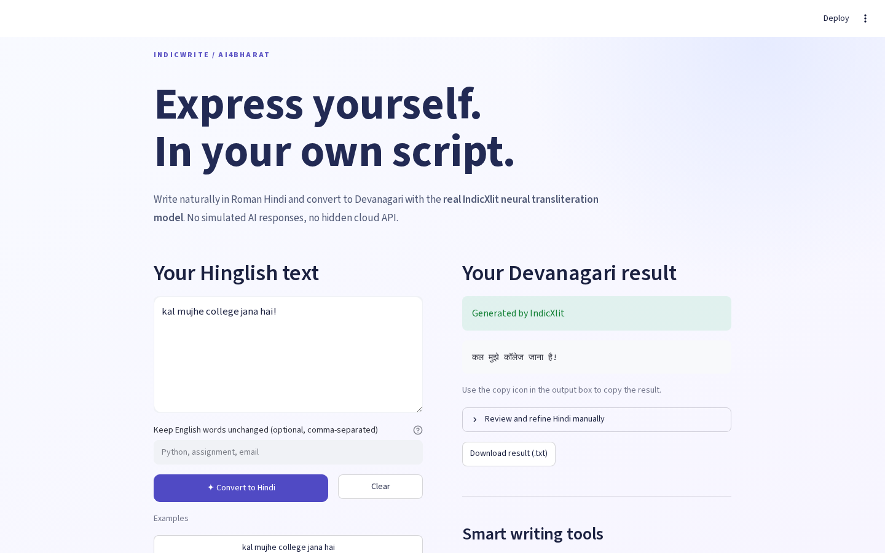
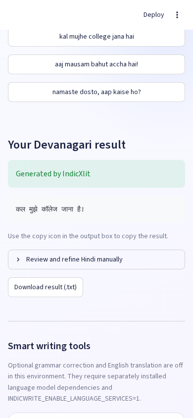

# IndicWrite — Hinglish Smart Writing Assistant

**CS3235 Working with LLMs · CIE3 Lab · RV University**  
**Student:** Munnaluri Rishikesh  
**USN:** 1RVU23CSE291  
**Individual mini-project · Option 4**  
**Submission deadline:** November 6, 2026, 10:00 AM IST  
**Experimental evidence date:** October 29, 2026

## Abstract

IndicWrite is an Indian-language writing application that converts Roman-script Hindi (Hinglish) to native Devanagari script. The initial end-to-end implementation uses the **genuine AI4Bharat IndicXlit pretrained neural model**, rather than hand-written mappings or simulated responses. It provides a Streamlit user interface with text validation, example inputs, protected English words, error handling, model attribution, and copyable/downloadable conversion results.

In executed experiments on a **40-case manually authored evaluation dataset**, the system achieved a **macro-average character error rate (CER) of 5.58%**, **macro-average word accuracy of 82.67%**, and **55% exact sentence match**. Results demonstrate practical Roman-Hindi conversion while highlighting failure cases, particularly ambiguous shortened spellings. Model-based grammatical rewriting with BharatGen Param-1 and English translation with IndicTrans2 remain proposed improvements and are **not** represented as implemented.

## 1. Problem definition and relevance

Hindi writers often use the Latin alphabet on mobile keyboards and in informal conversations. This Roman-Hindi text is convenient to type but may need conversion into Devanagari for academic, official, or accessible communication. Because there is no single standard spelling for informal Roman Hindi, transliteration is nontrivial: `main`, `mai`, `mein`, and abbreviations such as `ap` can be interpreted differently. English technical words and proper nouns introduce additional ambiguity.

This project aims to provide a usable Indian-language AI solution and evaluate it quantitatively rather than treating any visually plausible Hindi output as proof of correctness.

## 2. Objectives and scope

1. Convert Roman-Hindi words into native Hindi script using a genuine pretrained Indic language model.
2. Retain punctuation, whitespace, digits, acronyms, and existing Devanagari; allow explicit English-term preservation.
3. Provide a responsive interface with sample input, conversion feedback, output copying, download and clear control.
4. Validate at least 30–50 test inputs, measure accuracy, and discuss failures with recorded predictions.
5. Keep actual model inference, unit-test stubs, and future features clearly separated.
6. Document architecture, model attribution, limitations, and repeatable setup.

The faculty's complete Option 4 describes transliteration, sentence improvement and optional translation. This version **completes and validates the transliteration application**, but **does not yet implement grammatical rewriting**. Translation is explicitly optional and likewise unimplemented.

## 3. Model and dataset selection

| Component | Selection | Evidence status |
|---|---|---|
| Transliteration | AI4Bharat IndicXlit via `ai4bharat-transliteration==1.1.3` | **Pretrained model successfully executed** |
| Frontend | Streamlit with Python 3.10 | **Ran and interacted in Chromium** |
| Writing improvement | Candidate BharatGen Param-1-2.9B-Instruct | **Not installed, integrated, or executed** |
| English translation | Candidate AI4Bharat IndicTrans2 | **Not installed, integrated, or executed** |
| Training/data attribution | AI4Bharat Aksharantar | Cited as an official model resource, **not** claimed as the source of our manually authored tests |

IndicXlit is a multilingual transformer supporting 21 Indic languages. The application uses the Hindi (`hi`) path. The official repository is MIT-licensed. The package's legacy Fairseq checkpoint required special loading compatibility with modern PyTorch. The other candidate models require independent checks on licensing, access, runtime and task suitability before integration.

## 4. System architecture and implementation methodology

```text
Roman-Hindi text in Streamlit
       ↓
Input limits (500 characters / 80 Roman-script words)
       ↓
Tokenizer separates Latin words from spaces/punctuation/numbers/Hindi
       ↓
Preserve explicitly selected English terms and short uppercase acronyms
       ↓
Official AI4Bharat XlitEngine("hi", beam_width=4, rescore=False)
       ↓
Real model's top-1 Hindi prediction for each Roman word
       ↓
Reassemble converted and preserved tokens
       ↓
Streamlit results, copying and TXT download
```

The backend lazily initializes and caches the neural model once per Python process; within each request, repeated words use a small prediction cache. Each candidate Latin word is converted using the official `translit_word` interface. The application itself does not contain a hardcoded Hindi output dictionary. Errors from loading or inference are shown rather than replaced with fake AI responses.

The project contains `app.py`, `src/indicwrite/core.py`, `src/indicwrite/engine.py`, an executed `scripts/smoke_indicxlit.py`, `evaluation/evaluate.py`, and automated tests.

### 4.1 Compatibility engineering

On the first Ubuntu-based smoke run the official model package and roughly 121 MB model checkpoint downloaded successfully. A newer PyTorch build then rejected the legacy Fairseq checkpoint because `argparse.Namespace` was not allowlisted by default for restricted loading. We added a **narrowly scoped allowlist of that standard-library class when loading the official AI4Bharat weights**. The follow-up real-model run then succeeded. The application never accepts arbitrary third-party checkpoint files from users.

## 5. Experimental design

The evaluation corpus consists of **40 manually created sentences** in eight categories, with **five examples per category**:

- Ordinary Hinglish.
- Spelling variation and abbreviated Roman forms.
- Hindi-English loanwords.
- Names and locations.
- Punctuation.
- Code mixing with English terms kept in Latin script.
- Numbers and mixed alphanumeric tokens.
- Ambiguous Roman spellings.

Each record in `evaluation/cases.csv` has a unique ID, category, source Roman text, reference Hindi text, and optional English words to preserve. The recorded model output for every example is in `evaluation/results/predictions.csv`.

### 5.1 Metrics and definitions

For a reference string `R` and prediction `P`, character error rate (CER) is the Levenshtein distance at Unicode code-point level divided by the number of code points in `R`. Word error rate (WER) uses whitespace-delimited words and divides word-level edit distance by the reference word count. **Word accuracy is defined here as max(0, 1 − WER)**. Exact sentence match is 1 if normalized prediction equals normalized reference, otherwise 0. Each aggregate is a simple arithmetic average across sentences, **not a globally micro-weighted corpus score**.

These metrics measure agreement with authored references. Equivalent or acceptable variant spellings can receive nonzero error; the small corpus cannot establish nationwide model quality or official Aksharantar benchmark scores. This evaluation is for transliteration only, and does not measure grammatical rewriting.

## 6. Measured results

The genuine IndicXlit model ran on the full 40-case corpus in GitHub Actions, producing predictions, metrics and a failure sample file. **Observed results:**

| Metric | Value |
|---|---:|
| Cases executed | 40 / 40 |
| Mean CER | **5.58%** |
| Mean WER | **17.33%** |
| Mean word accuracy | **82.67%** |
| Exact sentence match | **22 / 40 (55%)** |

### 6.1 Performance by category

| Category | Cases | Mean CER | Word accuracy | Exact match |
|---|---:|---:|---:|---:|
| Ordinary Hinglish | 5 | 2.02% | 92.00% | 60% |
| Spelling variation | 5 | 17.06% | 49.33% | 0% |
| Loanwords | 5 | 1.60% | 96.00% | 80% |
| Names | 5 | 5.31% | 82.00% | 40% |
| Punctuation | 5 | 8.58% | 73.33% | 40% |
| Code mixing | 5 | 0.00% | 100.00% | 100% |
| Numbers | 5 | 7.00% | 87.00% | 60% |
| Ambiguous | 5 | 3.11% | 81.67% | 60% |

**Interpretation:** The model handles common Roman Hindi, loanwords, and explicitly protected English terms well on this small evaluation set. Spelling variation is by far the most difficult category. The perfect code-mixing score partially reflects human-supplied lists of English terms to preserve, not autonomous English/Hindi language identification.

## 7. Error analysis

Real predictions were checked against the reference sentences; these examples are copied from the executed `worst_cases.csv`:

| Roman input | Reference | Real model output | CER |
|---|---|---|---:|
| `ap kahan ho?` | आप कहाँ हो? | एपी कहन हो? | 36.36% |
| `mai theek hu.` | मैं ठीक हूँ. | माई ठीक हू. | 25.00% |
| `5 minute ruk jao!` | 5 मिनट रुक जाओ! | 5 मिन्यूट रुक जाओ! | 20.00% |
| `bengaluru se delhi jaunga.` | बेंगलुरु से दिल्ली जाऊँगा. | बेंगलुरु से देल्ही जौंगा. | 19.23% |
| `main aaunga; tum rukna.` | मैं आऊँगा; तुम रुकना. | मैन आऊंगा; टम रुकना. | 19.05% |

These are genuine model outputs, not examples synthesized to illustrate possible failures. Incorrect interpretations of short Roman words, Hindi vowels, and unfamiliar names are likely due in part to ambiguity without sentence-level context. These weaknesses motivate richer contextual reranking and constrained rewriting, but we do not claim they are fixed in the current MVP.

## 8. Executed testing and verification

- **Unit tests:** 14 tests passed on GitHub Actions. These test input handling, error propagation and metric calculations, and **use a fake engine** for deterministic text tests; their passing does not itself prove model inference.
- **Actual neural model:** Ubuntu 22.04, Python 3.10, downloaded official checkpoint. Smoke run `40870311669` printed `REAL_INDICXLIT_SMOKE_TEST_PASSED`.
- **Actual 40-case evaluation:** Run `40870722731` succeeded and committed authentic prediction/metric files. The JSON and CSV are retained in GitHub.
- **Actual web UI/browser:** GitHub Actions Chromium Playwright run `40871267464` completed conversions and Clear actions on desktop at 1440px and mobile at 390px, with no detected page-level JavaScript errors or horizontal overflow. A follow-up run `40872355065` also passed and captured a mobile screenshot with the real result visible.

### 8.1 Actual desktop application screenshot



### 8.2 Actual mobile converted-result screenshot



Screenshot images are artifacts captured from the **running Streamlit application executing the real neural model**, not designer mockups. Both the screenshots and their browser QA JSON are committed in the repository.

## 9. Limitations and future work

The current model transliterates individual words; it **does not improve full-sentence grammar**, despite the broader smart-writing project name. No sentence-level semantic or contextual reranker is deployed. English terms are only preserved when manually specified or handled by a simple acronym rule. Some transliterations admit equally valid reference alternatives, so errors may overstate actual user dissatisfaction. The verification environment is Linux/Ubuntu; local native Windows installation may need WSL2 because of legacy Fairseq dependencies. No public deployment is asserted.

The next development phases would evaluate BharatGen Param-1 for grammatical rewriting (including meaning-preservation human evaluation), implement optional Hindi-to-English translation with IndicTrans2 if resources allow, add standard Aksharantar evaluation with correct splits and licensing, and consider context-aware candidate ranking, more nuanced mixed-script handling, and broader accessibility/device testing.

## 10. Conclusion

IndicWrite now provides an independently testable Indian-language AI transliteration application, with a responsive Streamlit interface, genuine AI4Bharat IndicXlit inference, forty measured cases, transparent failure analysis and real desktop/mobile screenshots. The reported performance and implementation scope are grounded in saved logs and results, while rewriting/translation remain unimplemented and explicitly documented.

## References

1. [AI4Bharat IndicXlit official repository and documentation](https://github.com/AI4Bharat/IndicXlit).
2. [Official AI4Bharat IndicXlit Python interface](https://github.com/AI4Bharat/IndicXlit/tree/master/app).
3. [AI4Bharat Aksharantar dataset](https://huggingface.co/datasets/ai4bharat/Aksharantar).
4. [ai4bharat-transliteration on PyPI](https://pypi.org/project/ai4bharat-transliteration/1.1.3/).
5. [BharatGen Param-1-2.9B-Instruct model information](https://huggingface.co/bharatgenai/Param-1-2.9B-Instruct).
6. [AI4Bharat IndicTrans2 official repository](https://github.com/AI4Bharat/IndicTrans2).
7. [PyTorch serialization behavior](https://docs.pytorch.org/docs/stable/notes/serialization.html).
8. [This project's recorded smoke test](https://github.com/Rishikeshsanin/Hinglish-Smart-Writing-Assistant/actions/runs/40870311669), [evaluation run](https://github.com/Rishikeshsanin/Hinglish-Smart-Writing-Assistant/actions/runs/40870722731), and [browser QA run](https://github.com/Rishikeshsanin/Hinglish-Smart-Writing-Assistant/actions/runs/40871267464).


## 11. Further real-model experiments and restrictions (October 29, 2026)

The live BharatGen metadata currently advertises Apache-2.0, while repository history contains a restrictive BharatGen Research License and the license file has since changed. Because that state is inconsistent, public output or hosting remains blocked pending written clarification. This project does not claim to have executed BharatGen or obtained publishing approval.

A real run of the independently authored, MIT-licensed Hindi mT5 grammar checkpoint `manavdhamecha77/GEC-mT5-Small-Hindi` yielded severe Bengali/mixed-script drift from Hindi prompts, including `আমি স্কুলে যাবে?` from `मैं स्कूल जाता है।`. It is a **failed model-quality experiment**, not a completed writing-improvement feature. Another model, `Rucha-Ambaliya/mt5-small-indic-gec`, had only 1/5 exact matches on five test sentences (same score with raw and instruction-prefixed input). The grammar UI is disabled by default to avoid misleading users.

A third research-only candidate, `Qwen/Qwen2.5-0.5B-Instruct`, exactly corrected 2/5 screening cases but translated one case into English with changed meaning and made a severe noun substitution in another. This is also a failed quality experiment, not an integrated feature.

`Qwen/Qwen3-0.6B` was also genuinely screened and exactly corrected 0/5 cases; one output removed a meaning-bearing word. It is likewise not integrated.

A separately attributed, Apache-2.0 Helsinki-NLP OPUS-MT Hindi-English model was successfully executed on two sentences, returning `I have to go to college tomorrow.` and `Hello, how are you?`. This independent optional translation feature is **not AI4Bharat IndicTrans2**. The original 40-case IndicXlit CER/accuracy remains a transliteration-only result, not a measure of grammar or translation.

Evidence: https://github.com/Rishikeshsanin/Hinglish-Smart-Writing-Assistant/actions/runs/40876423545, https://github.com/Rishikeshsanin/Hinglish-Smart-Writing-Assistant/actions/runs/40876907788, https://github.com/Rishikeshsanin/Hinglish-Smart-Writing-Assistant/actions/runs/40877372435, and https://github.com/Rishikeshsanin/Hinglish-Smart-Writing-Assistant/actions/runs/40878109536. BharatGen license history: https://huggingface.co/bharatgenai/Param-1-2.9B-Instruct/commits/main.


## 12. Engineering hardening and final release gates

Following independent QA, the implementation now validates input and preservation settings before neural model loading, clears stale results whenever preservation settings change, labels unchanged Hindi text accurately, and conservatively preserves complete Unicode words and structured items such as emails and URLs. Browser QA now records the actual generated Devanagari text, checks the exported UTF-8 data, verifies Clear and checks horizontal overflow. These repairs do not alter the historical 40-case reference dataset or retroactively change the measured scores.

The experimental BharatGen research loader has been hardened to pin a reviewed model revision and hashes of custom Python files, require explicit remote-code opt-in, enforce a prompt budget and complete EOS handling, and reject non-Hindi/incomplete outputs. The model **was subsequently executed** in a private Google Colab T4 experiment (details in Section 13). No broad grammatical accuracy or independent meaning-preservation score is claimed. The separate public-model licensing question is unresolved.

The UI has been tested for desktop and narrow Chromium viewports, but a full screen-reader, keyboard, high-zoom, and WCAG audit has not been completed. Any public deployment requires an external reachable conversion test and resource measurements. The project is therefore a verified transliteration and optional independently-attributed translation prototype, not a fully validated BharatGen rewriting application.

## 13. Genuine BharatGen private GPU inference and measured runtime

On 29 October 2026 a user-authorized, **private** Colab Tesla T4 session successfully loaded the official `bharatgenai/Param-1-2.9B-Instruct` checkpoint, pinned to revision `f9b32a727458727ff515fea5d82df00ae9b7ad56`, and executed actual generative inference through the audited adapter. The experimental environment was Python 3.12.16, PyTorch 2.6.0+cu124, Transformers 4.56.2 and FP16, with the checkpoint mapped entirely to CUDA.

The **single-case smoke run succeeded** and **all ten preregistered Hindi research cases generated usable, EOS-terminated, nontruncated Devanagari candidates**. Across those ten cases, mean candidate generation latency was approximately 1.01 seconds; peak PyTorch allocated GPU memory was ~6.31 GiB (not total system RAM). Initial download/load timing depends on cache state and should not be generalized to deployment performance.

An initial, non-specialist editorial review indicated **nine of ten examples were acceptable or correctly left unchanged; one was not acceptable**, with an altered technical term and unresolved grammatical agreement. This is a small, self-authored research sample and not a formal quality certification, broader statistical accuracy estimate, or independent linguist assessment. The earlier 40-case IndicXlit transliteration results remain a separate experiment.

**Publication limitation:** BharatGen's research-license history restricts public output and checkpoint distribution without approval. Raw outputs remain private. No public BharatGen service is deployed; the localhost interface still requires live private-GPU browser QA.


## 14. Deployment reproducibility and model-fidelity decision

For classroom use, a private Docker Compose configuration was added that binds the host to loopback only, explicitly disables private BharatGen, and runs the official AI4Bharat IndicXlit model. Its GitHub Actions run **40898600397** successfully built the image, executed genuine pretrained model inference inside the image and verified local Streamlit health. Thus the reproducible local demonstration was tested, not merely documented.

A public deployment was **not** claimed. The official model depends on a legacy Python 3.10/Fairseq stack, and Python 3.10 reached its security end of life on 1 October 2026. To assess a supported-Python option, an independently contributed CTranslate2 conversion was tested on all 40 authored reference examples under Python 3.12. It achieved **11.54%** mean CER, **67.83%** mean word accuracy and **6/40** exact reference matches; the genuine official runtime had **5.58%**, **82.67%**, and **22/40**, respectively. Only **8/40** converted predictions were identical to the saved official predictions. This is a concrete example of why technically executable alternatives must pass comparative evaluations before deployment. The inferior converted model was rejected without changing the application or its historical evaluation.

**Consequently, deployment readiness is local-only.** The remaining independent requirements for an internet-facing release are a supported secure runtime with acceptable model fidelity, explicit hosting authorization, BharatGen public-output permission if that private research capability is exposed, and a real external-browser verification. No paid service or unrelated project infrastructure was used.
